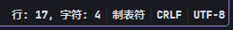
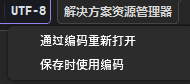
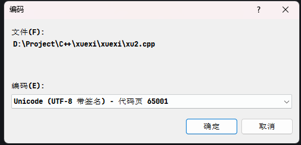

# C 语言学习

从这一篇开始, 我们将开始学习 C 语言的基础知识。
C 语言是一种 __静态类型语言__, 它的语法简单, 但是功能强大。
面向 __过程__ 的编程语言, 它强调 __函数__ 的使用, 而不是 __对象__ 的使用。

## 快速开始:

### C模板
```cpp
#include <stdio.h>
int main()
{
    printf("Hello World!\n");
    return 0;
}
```

这里的 `<stdio.h>` 是标准输入输出 __头文件__, 包含了 `printf` 函数, 用于输出字符串到标准输出设备 (通常是屏幕)。

`main` 函数是 __C 语言程序的入口__, 它返回 __0__ 表示程序 __成功执行__,  __其他值__ 表示程序 __执行失败__。

`int` 表示 __整数类型__, 这里返回 __0__ 表示程序成功执行。在后续的函数学习中, 我们会看到其他类型的返回值, 例如 `char`、`float` 等。

`printf` 函数用于输出字符串到标准输出设备,里面的字符串可以包含格式化字符, 例如 `%d` 表示输出整数, `%s` 表示输出字符串等。`\n`表示换行符, 用于在输出字符串后换行。

>[!NOTE]
>关于 `%d` 格式化字符:
> 例如, 下面的代码会输出 `1`:
>```cpp
>int a = 1;
>printf("%d", a);
>```

>[!TIP]
>如果文件的保存编码不是 __UTF-8 with BOM__, 则可能会导致输出中文乱码。
>解决办法:
> - 方法一:
> 将文件保存为 __UTF-8 with BOM__ 编码。
> 底部有 __UTF-8__ 编码的标识, 例如:
> 
> 点击一下这个标识, 就可以将打开这个下拉框。
> 然后点击 __保存时使用编码__。
> 
> 选择 __UTF-8-带签名__ 即可。
> 
> 然后点击确定即可。
> - 方法二:
> 在文件开头增加 `<Windows.h>` 头文件, 并使用 `SetConsoleOutputCP(CP_UTF8)` 函数设置控制台输出编码为 __UTF-8__。
>```cpp
>#include <stdio.h>
>#include <Windows.h>
>int main()
>{
>   // 设置控制台输出编码
>   // CP_UTF8 表示 UTF-8 编码(65001)
>   // 此函数在 Windows 系统下有效
>   SetConsoleOutputCP(CP_UTF8);
>   printf("Hello World!\n");
>   return 0;
>}
>```